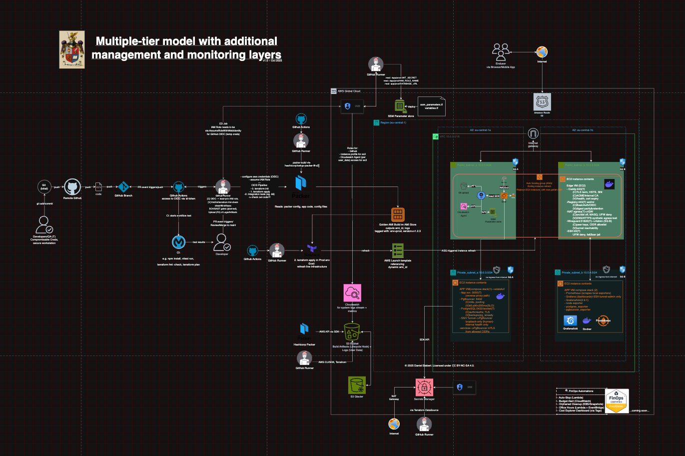

<h1 align="center">Daniel Siebert</h1>

<p align="center">
  <strong>Cloud FinOps & Financial Operations · AWS · Infrastructure as Code · AI automation</strong><br/>
  Stuttgart, DE · CV, projects, consulting → <a href="https://siebert.cv">siebert.cv</a> (DE/EN)
</p>

<p align="center">
  <a href="https://siebert.cv"></a>
  <a href="https://www.credly.com/badges/b0636d98-bade-44df-8a5b-3312e3711bf8/public_url"></a>
  <a href="https://www.credly.com/badges/8e5d77af-10af-4853-ba3f-25a84711fd54/public_url"></a>
</p>

---

## Focus

FinOps Engineer and AWS Cloud Solutions Architect. Background: 15+ years in finance, controlling, SAP and IT management. Current work: Cloudability-based cost evidence, a CI-driven weekly FinOps source pipeline, configuration-as-code for Targetprocess, and platform engineering on GCP/AWS — including consulting client engagements.

GitHub is the technical workspace; CV and consulting details live on [siebert.cv](https://siebert.cv).

---

## Current work (repositories private or company-owned)

| Project | Technical summary |
|---------|-------------------|
| **Cloudability evidence pipeline** (consulting) | Pulls customer views from the Cloudability EU API (host allow-list, key only in process env). AWS rightsizing per service (EC2, EBS, S3, RDS, EIP), GCP (GCE, MIGs, disks), commitments across AWS/Azure/GCP with 1y/3y kept apart. Each pull = evidence folder: request log, SHA-256 per page, explicit currency or gap, coverage check (row count, unique resources, total). Workbook built separately; console and API values never share a cell. |
| **Weekly FinOps source desk** (consulting) | Per ISO week: source pack + HTML newsletter from primary sources (AWS/Azure/GCP blogs, FinOps Foundation, FOCUS, AI vendors). Scoring/mix selection, optional LLM call for the lede only, send lock per week, GitHub Actions as release path, tested pack build. |
| **Targetprocess configuration pipeline** (consulting) | Extractor to versioned JSON snapshots; generated as-built docs, entity-model diagram, snapshot changelog, rule dependency graph, health check. Provisioner back into Targetprocess with explicit dry-run; deletes blocked by default; sandbox/prod separated. |
| **HappyImmo platform** | Four repos (Infrastructure, DataPool, Backend, Frontend). Terraform, ephemeral Cloud SQL PostgreSQL 16 + PostGIS, Workload Identity Federation for keyless GitHub Actions, budget alerts. 41 versioned Python ETL ingestion domains. Node 24 Express (Pino, prom-client) → PgBouncer (transaction pooling) → Postgres. Vite/React/TS frontend. Prometheus, Grafana, Loki. |
| **Tender Agent** | Multi-agent EU procurement pipeline: LangGraph, Grok (xAI), auditable gates, human-in-the-loop chapter drafting. |
| **siebert.cv** | Next.js 16 App Router (Turbopack), React 19, TypeScript, DE/EN i18n, Vercel Analytics, GitHub Actions CI on Node 24 (CV content contract, 31 HTTP E2E + 49 Playwright viewport checks). |

Details: [siebert.cv/en/projects](https://siebert.cv/en/projects).

## Public repositories

| Repo | Technical summary |
|------|-------------------|
| [AWS_grocery](https://github.com/DanielSiebert-dev/AWS_grocery) | Fork (Masterschool cloud track): Terraform + Bash, immutable EC2 rollouts via ASG, Secrets Manager, bastion deploy, RDS PostgreSQL, Nginx static hosting. |
| [InstaScraper](https://github.com/DanielSiebert-dev/InstaScraper) | Python, Instaloader, Oxylabs proxy rotation, scheduling, deduplication, SQLite persistence, email notifications. |
| [GitHub-Stats-Visualization](https://github.com/DanielSiebert-dev/GitHub-Stats-Visualization) | Python: custom language/activity charts for GitHub profiles. |

---

## Stack

| Area | Tools |
|------|-------|
| **Cloud** | AWS (EC2, RDS, Lambda, VPC, IAM/OIDC, Secrets Manager, SSM, KMS, CloudWatch), GCP (Cloud SQL, Cloud Run, WIF) |
| **IaC / DevOps** | Terraform, Docker, Docker Compose, Kubernetes, GitHub Actions, Bash |
| **FinOps** | Cloudability (IBM Apptio), AWS cost transparency, tagging governance, budgets, rightsizing, commitments, FOCUS |
| **Observability / Edge** | Prometheus, Grafana, Loki, CloudWatch, Caddy, WireGuard, PgBouncer |
| **Languages / Web** | Python, TypeScript, JavaScript, Next.js, React, FastAPI, REST, Tailwind CSS |
| **Data** | PostgreSQL/PostGIS, SQLite, ETL, GeoPandas |
| **AI / Automation** | LangGraph, Grok (xAI), human-in-the-loop, n8n, Playwright |
| **Finance / ERP** | SAP FI/CO, PS, MM, SD; cost center, project and IT controlling; ITFM |

## Certifications

- AWS Certified Solutions Architect – Associate · [Credly](https://www.credly.com/badges/b0636d98-bade-44df-8a5b-3312e3711bf8/public_url)
- AWS Certified Cloud Practitioner · [Credly](https://www.credly.com/badges/8e43f1a6-9041-4a01-bf7a-487e17030854/public_url)
- FinOps Certified Practitioner (FinOps Foundation) · [Credly](https://www.credly.com/badges/8e5d77af-10af-4853-ba3f-25a84711fd54/public_url)
- IBM Apptio Cloudability Technical Sales Intermediate · [Credly](https://www.credly.com/badges/6b20a6b0-4475-4966-b0f7-d8af0ab6bd13/public_url)
- IBM Cloudability Essentials Practitioner Advanced · [Credly](https://www.credly.com/badges/296686af-e8dd-4fb6-a360-75f9b3b67ff7/public_url)
- IBM Cloudability Sales Foundation · [Credly](https://www.credly.com/badges/474cccff-e4a0-4447-883a-7b8d049a6745/public_url)

---

## Reference architecture

Private AWS environments I design around a **split edge + app plane** — TLS at the edge, east-west traffic in private subnets, FinOps jobs on the control plane:

<details>
  <summary><strong>CI/CD · Control · Data plane (click to expand)</strong></summary>

  <p align="center">
    
  </p>

  ```text
                        CI/CD PLANE                      CONTROL PLANE
+------------------+        |                     +------------------------------+
| Devs / QA        |        | OIDC trust          |  IAM / KMS / SSM             |
| pull requests    |  ----> | assumption policy   |  - Roles for CI & EC2        |
+------------------+        |                     |  - KMS keys for SSM          |
                            v                     |  - SSM params (registry/app) |
                    +------------------------+    +------------------------------+
                    | GitHub Actions Runner  |
                    | - Artifact build       |          DATA PLANE
                    | - Push to Registry     |          (east–west & north–south)
                    +-----------+------------+
                                |
                                | HTTPS push/pull (443)
                                v
==============================  AWS VPC (10.0.0.0/16)  ====================================
| Public Subnet (10.0.1.0/24)                                      Private (10.0.2.0/24)     |
|                                                                                            |
| +------------------------------------------+     mTLS/HTTPS proxy     +---------------+    |
| | Edge VM                                  | <------------------------ | App VM        |   |
| | - Caddy (TLS termination, SNI routing)   |                           | - App         |   |
| | - Split Registry (ext/int DNS)           |   outbound through NAT    | - PgBouncer   |   |
| | - NAT (masquerade, src/dst check off)    | ----------------------->  | - Postgres    |   |
| | - WireGuard (51820/UDP admin plane)      |                           +---------------+   |
| | - UFW default-deny; fail2ban sshd        |                                               |
| +------------------------------------------+                                               |
=============================================================================================
       |              |                  |                          |
       v              v                  v                          v
  Route53/NS     TLS issuance      SSM param reads             FinOps jobs
  (A/ALIAS)      (internal CA or   (pull credentials &         (Auto-Stop, Office Hours,
                 ACME public)      runtime config)             Orphaned Cleanup, Budgets)
  ```

</details>

---

## Contact

- Web: [siebert.cv](https://siebert.cv)
- Appointment: [cal.com/daniel-siebert-for-you](https://cal.com/daniel-siebert-for-you/30min)
- LinkedIn: [daniel--siebert](https://www.linkedin.com/in/daniel--siebert/)
- Email: [daniel@siebert.cv](mailto:daniel@siebert.cv)
- Code questions: issues on the relevant public repo

*Last updated: October 2026*
